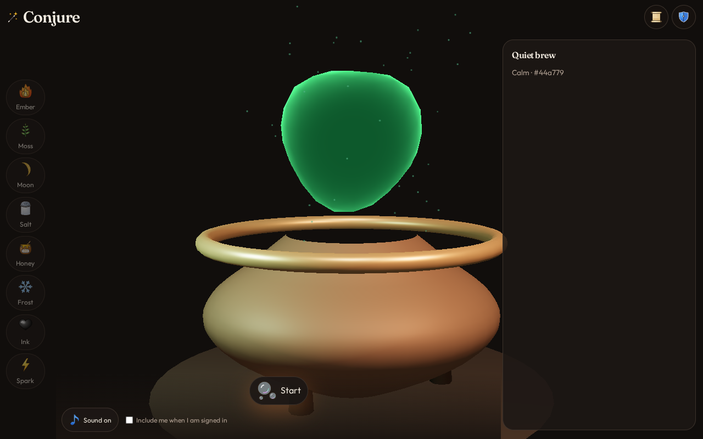
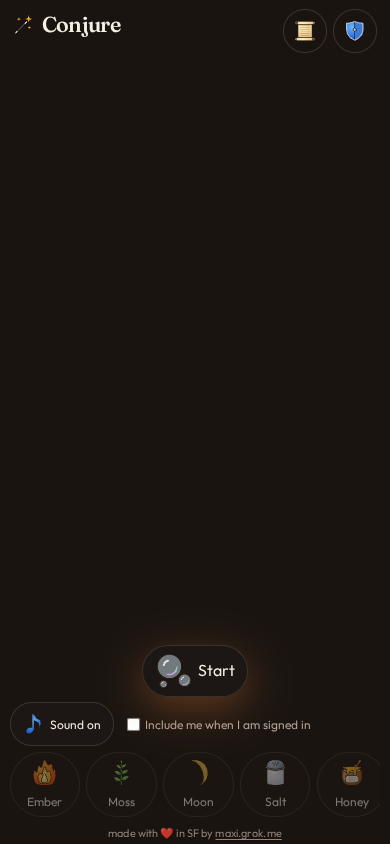

# Conjure

Friends share one cauldron. Drop an ingredient, stir it with a sensor or a finger, capture the brew, and replay it from a link. When a collection contract is set, you can mint that brew on Robinhood Chain testnet and transfer the NFT from your own wallet.

Xero Emoji by Max Infeld, CC BY 4.0 — https://github.com/maximusmaximus/xeroemoji

## Try it

1. Tap **Start**, or drop an ingredient. The first drop opens the cauldron.
2. Drop Ember, Moss, Moon, Salt, Honey, Frost, Ink, or Spark. Keys 1–8 do the same. The brew takes that color, a charm falls into the pot, sparks fall with it, concentric rings run across the surface, the ladle takes a spin, and you hear a tone. That button then leaves the stage. A tap, a hit, a tilt, or a shake starts more rings. The surface tilts and sloshes with the pot.
3. The pot keeps turning on more than one axis and breathes in and out. Drag and fling still steer it. A throw, a tap, or a loud sound speeds the tumble and the pulse, then the drag eases out and the pot returns toward that idle motion. Charms, sparks, and droplets spill over the rim as it leans, bounce on the ground, and get pulled back in. Grab one and throw it. Hits squash for a moment, and a phone that can vibrate ticks on the hit. The camera distance is fitted to the view, so the cauldron at its largest breath and tilt, plus the spill, stays on screen with a small margin. A portrait window of any width uses that portrait fit, including large phones and narrow windows. Add `?debug=1` to see the live window, canvas, pixel ratio, camera, field of view, portrait or desktop, and the fitted margin.
4. Tap the eye to bring the controls back. **Mic**, **Camera**, and **Motion** each kick the brew the moment you tap them: a swell, a color, and a spin. If the phone allows it, loudness, a color sample, and tilt keep feeding that motion. Only levels leave the phone. A used sensor button leaves with the rest of the tray.
5. At **Master**, the eye also brings **Stir**, **Hue**, **Swirl**, **Bloom**, and **Freeze**. Each one changes the brew while you drag it. Freeze stops the spin. Letting go of a tool puts that slider away.
6. Tap **Capture** for a still, a 6 second loop, and a recipe. The still is taken while the brew is still turning. The loop is the canvas for those 6 seconds, spin included. The GLB stores that same ease-out as an animation, plus the angular velocity, axis, damping, and spin count. **Share** copies a replay link that plays the spin again. **Remix** keeps the lineage.
7. **Gather** opens a four-character code. Up to 12 players join. Others can watch. The host can lock, remove, or hand off the room. A capture asks each guest Include me / Leave me out. Silence leaves them out.





## Levels

Use earns XP, a daily streak, and badges. The same action only counts a few times each day.

| Level | XP | What opens |
| --- | --- | --- |
| Spark | 0 | Start, ingredients, fling |
| Stir | 24 | The streak and badges start to fill in |
| Circle | 70 | Gather is part of the loop |
| Keep | 120 | Wallet: testnet mints and ERC-721 transfer |
| Master | 180 | Highest resolution the GPU allows, plus Tools |

**Next** stays on screen and names the following action. Short tips explain a step once. Dismiss a tip with X or a sideways swipe. A dismissed tip does not return on this device.

**Master** raises the drawing buffer to the screen's device pixel ratio, capped by `MAX_TEXTURE_SIZE` and an 8 megapixel budget, and never above 3. It is also the full materials path: glass transmission on the potion and crystal charms, iridescence, clearcoat, sheen, bloom, contact shadows, a little depth of field, and AgX tone mapping. Mid and high tiers use a lighter glass and bloom, ACES tone mapping, and no depth of field. A low-end phone stays on standard materials, skips bloom, shadows, and depth of field, and keeps the fewest charms, sparks, and droplets so the cauldron can hold 60fps. Master keeps the most. Adaptive device pixel ratio eases the buffer down if a frame runs long. Tools are stir, hue, swirl, bloom, and freeze. They sit on the stage, not over it, and each one moves or recolors the brew as you use it. The mesh, ember, and body counts step up with the tier.

The eye control is a Xero Emoji. It is the only control that stays after you have used the others. Open it and the ingredients, sensors, and tools come back. Close it and the stage is just the cauldron.

## Wallet

Robinhood Chain testnet only. Chain id **46630**. Public RPC `https://rpc.testnet.chain.robinhood.com`. Explorer `https://explorer.testnet.chain.robinhood.com`.

Connect the wallet already in the browser. You pay gas. The app does not hold a relayer key and does not switch the wallet to mainnet.

`CHAIN.contract` in `src/conjure/chain.ts` is a public constant. It is empty in this build, so mint and transfer do not submit a transaction. When that constant is a contract address, mint calls `mint(address,string)` and transfer calls ERC-721 `transferFrom`, signed in the connected wallet through viem. Reads use a wagmi public client on the same testnet. Owned token ids come from `Transfer` logs. Local mint notes stay on this device.

Mint metadata is a JSON file you can download from the capture. `animation_url` is the 6 second loop (a `data:video/webm` URL when the recording succeeded, otherwise the replay link that plays the same spin). `attributes` include angular velocity, axis, damping, spin count, gravity, the physics seed, body count, transmission, IOR, thickness, iridescence, emissive intensity, bloom, tone mapping, tier, rotation, scale, scale range, spill lip, and body cap. `properties.physics` is the snapshot taken when the capture starts: seed, gravity, and each body's position and velocity. `properties.material` is the tier's glass and post settings at that same moment. `properties.motion` is the rotation, the breathing scale, and the spill lip, mouth, ground, and body cap. The still is the image. Robinhood Chain testnet only.

Daily mint touches are capped at 5 per device.

## Board

The board is opt-in. Open it from the level sheet, set a pseudonym or an emoji handle, and choose **Show me on the board**. Anyone can read the list. Your row is posted only after you opt in. The row is a handle, XP, streak, and level. No wallet, email, or real name is stored. **Hide me and delete my row** removes it. Until you opt in, your score stays on this device.

## Privacy and sensors

Mic, camera, and motion start only after you tap them. Raw audio and camera frames stay on the device. A circle receives loudness, pitch, a hue, tilt, and wave. A color sample is a number. Group capture asks before anyone but the host is included. There is no chat. Display name and an anonymous device id live in this browser. Room state is stored so other phones can join the same code. Share and remix counts are first-party. There is no third-party analytics.

## Architecture

The cauldron is a React route. Brew math in `src/conjure/brew.ts` turns drops and sensor levels into hue, energy, and form. `src/conjure/scene.tsx` draws that with three.js on WebGL2: physical glass where the tier allows it, a room environment from three.js `RoomEnvironment` through PMREM, bloom and optional depth of field, and additive ember particles. The pot's idle tumble and breathing scale live in `src/conjure/spin.ts` and add to the fling, which still damps out. `src/conjure/frame.ts` fits the camera distance from the aspect so the pot's largest scale and tilt, and the spill, stay inside both the horizontal and vertical field of view. Portrait is any view taller than it is wide. `src/conjure/physics.ts` is a small seeded solver for charms, sparks, droplets, and the liquid slosh grid. Bodies can leave the rim, bounce, and come back. `src/conjure/fx.ts` maps the quality tier onto those effects and caps the body count. If WebGL2 is missing, `src/conjure/flat.tsx` draws the same brew and the same falling bodies on a 2D canvas. A WebGPU adapter, when present, only picks the quality tier.

Rooms poll `POST /api/conjure` about once a second. Tables live in `migrations/0002_conjure.sql` and `migrations/0003_board.sql`. Rows are unowned: there is no account system. Preview uses embedded Postgres when `DATABASE_URL` is unset. A hosted database uses that URL.

Creations, tips, XP, and the opt-in choice persist in `localStorage`. A share link carries the recipe in the query string so a replay does not need the original phone.

## Stack

- TanStack Start, React 19, Vite
- three.js and React Three Fiber, with a custom rigid-body step (no extra physics package)
- Tailwind CSS v4
- zustand
- viem and wagmi for the testnet wallet
- Xero Emoji SVGs, self-hosted under `public/xeroemoji/`

## Setup

```bash
npm install
npm run dev
```

No secrets are required. Do not put a relayer key, Pinata JWT, or mainnet RPC in the repo. The only chain constant meant to change in public is `CHAIN.contract`.

## Scripts

| Script | What it does |
| --- | --- |
| `npm run dev` | Dev server |
| `npm run build` | Production build, copies the embedded database assets, applies SQL when `DATABASE_URL` is set |
| `npm run preview` | Serves the production build |
| `npm run typecheck` | `tsc --noEmit` |
| `npm test` | Unit tests, including brew, consent, XP, fling, pixel-ratio caps, tier effects, and mint physics metadata |
| `npm run db:migrate` | Applies `migrations/*.sql` when `DATABASE_URL` is set |
| `node scripts/check-manifest.mjs` | Checks artwork licenses in `assets/MANIFEST.json` |

## Testing

`npm test` covers brew mapping, consent defaults, the mint-touch cap, level thresholds, daily XP caps, streaks, tip dismissal, handle filtering, fling decay, the master pixel-ratio cap, the tier-to-effects map, camera framing at 360×780, 390×844, 430×932, 500×1030, 768×1024, 1280×800, and 1920×1080 (the scaled pot and the spill stay inside the view), bounce restitution, spill returning to the pot, breathing scale bounds, and the physics, material, rotation, and spill fields on mint metadata.

The contract in `contracts/Conjure.sol` is a minimal ERC-721 with a fixed 5% ERC-2981 royalty and `transferFrom`. This environment does not run Foundry, so that file is not executed here.

## Deploy

`npm run build` writes a Vercel-ready output. Set `DATABASE_URL` on the host if rooms and the board should survive a restart. Leave it unset and the app still runs with the embedded database for that process. Wallet traffic uses the public testnet RPC from the browser. Nothing in the deploy step adds a paid service.

## Asset licenses

Code in this app is MIT (`LICENSE`).

| Asset | License |
| --- | --- |
| Cauldron, brew, and forms | CC0-1.0. Drawn in the browser. No external mesh. |
| Room lighting | MIT. three.js `RoomEnvironment`, baked to a PMREM in the browser. No downloaded HDRI. |
| Icons | Xero Emoji by Max Infeld, CC BY 4.0. https://github.com/maximusmaximus/xeroemoji |

The footer uses the Xero laptop emoji as the link to https://github.com/maximusmaximus/conjure.
